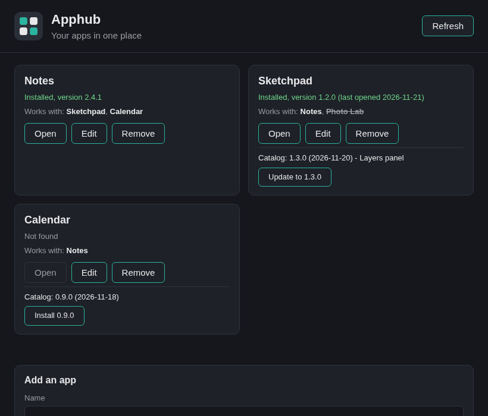

# Apphub



A small desktop hub that keeps your apps in one place. Apps show up on the list by themselves;
Apphub finds where each one is installed, shows its version, opens it, notes which apps work
together, and can install or update apps from a catalog folder you choose.

It starts empty: no apps, no catalog, nothing blocked. Built with [Tauri 2](https://tauri.app)
(Rust and plain HTML/JS). Runs on Linux and Windows.

## Download

Get the Linux AppImage or `.deb`, or the Windows setup, from the
[Releases](../../releases) page. There is no macOS build yet.

The Windows setup is not code-signed (signing costs money), so Windows SmartScreen will warn
the first time. Click **More info**, then **Run anyway**.

## How apps get on the list

Nothing has to be typed in. An app shows up by itself when:

- it writes an **announce file** (see below), which also gives its version, program and the
  apps it works with, or
- it is in your **catalog** folder, so you can install it from the card.

**Remove** takes an app off the list and keeps it off, even if it would be found again. It does
not uninstall anything. Adding it again by name brings it back.

## Adding an app by hand

For an app that does neither, give it a **name** (as it shows in your app menu), and optionally:

- **Program**: the full path to its program. Leave it empty to let Apphub find it.
- **Works with**: other app names, comma-separated. A name that is not on your list is shown
  struck through.

## How an app is found

For each app on the list, in this order:

1. **The program you set.** Used as is, if the file exists and is not in a blocked folder.
2. **The announce file** `<settings folder>/apps/<name>.json`, which an app can write about itself
   (see below).
3. **The launcher**: on Linux a `.desktop` file in `~/.local/share/applications` whose `Name=`
   matches; on Windows the app's entry under *Apps & features* (read-only, current user).

The program is always looked up again when you click **Open**. A path is never taken from the page.

## Announce file

An app can tell Apphub where it is by writing this file each time it starts:

```json
{
  "schema_version": 1,
  "app": "Notes",
  "version": "2.1.0",
  "exe": "/opt/notes/notes",
  "seen_at": "2026-11-22T09:30:00Z",
  "works_with": ["Sketchpad"]
}
```

`works_with` is optional. If you set **Works with** yourself, yours is used instead.

Apphub writes one for itself at startup.

The settings folder is the platform config folder for `io.github.apphub`. That is
`~/.config/io.github.apphub` on Linux and `%APPDATA%\io.github.apphub` on Windows. The page's
Options section shows the exact path.

## Catalog (install and update)

Set a catalog folder in **Options**. Each app gets its own subfolder holding its setup and a
`latest.json`:

```json
{
  "app": "Notes",
  "version": "2.1.0",
  "setup": "Notes_2.1.0_x64-setup.exe",
  "sha256": "<64 hex characters>",
  "released": "2026-11-22",
  "notes": "Faster search"
}
```

- `app` is matched against the name on your list (case does not matter).
- `setup` is a plain file name in the same folder. On Windows it must be an `.exe`.
- The card offers **Install** (not installed) or **Update** (newer version). Versions compare as
  `x.y.z`, and a release beats its own pre-releases (`1.0.0` > `1.0.0-beta.3`).
- Install takes two clicks. Apphub first copies the setup to a temp folder, then checks the
  copy's SHA256 against `latest.json`. On a mismatch the copy is deleted and nothing runs.
  The setup then starts with its normal window. It never runs silently. If the setup asks for
  admin rights, Apphub does not start it and tells you so.

## Blocked folders

Options has a list of folders and drives, one per line (for example `/mnt/share` or `S:`).
Apphub never opens or installs anything from a blocked folder, and never uses one as the catalog.
The list is empty by default.

## Settings safety

Settings are saved to `settings.json` in the settings folder. Each save writes a temp file and
then renames it, so a crash cannot leave a half-written file. If the file is damaged, Apphub shows
an error and refuses to save over it, so you can fix it by hand without losing it.

## Build and test

Needs Rust (stable) and Node.js. On Linux it also needs the
[Tauri system packages](https://tauri.app/start/prerequisites/).

```bash
npm install
cd src-tauri && cargo test
npm run dev          # run with live reload
npm run build        # AppImage/deb on Linux, NSIS setup on Windows
```

## Related apps

Apphub is one of a small set of separate, GPL-3.0 tools:

- [Swarf](https://github.com/matthewjaybarr-png/swarf): G-code editor setup for Neovim
- [Crib](https://github.com/matthewjaybarr-png/crib): tool book editor and machine-side viewer
  for CNC shops. It writes an announce file, so it shows up in Apphub by itself.
- [Jig](https://github.com/matthewjaybarr-png/jig): set-up sheets for CNC programs, one sheet per
  program, with PDF and HTML offline copies
- [Gauge](https://github.com/matthewjaybarr-png/gauge): machining calculator for speeds and
  feeds, drills, taps, thread milling and geometry. Works offline.

## Licence

GPL-3.0-or-later, see [LICENSE](LICENSE). Copyright (C) 2026 the Apphub contributors.
